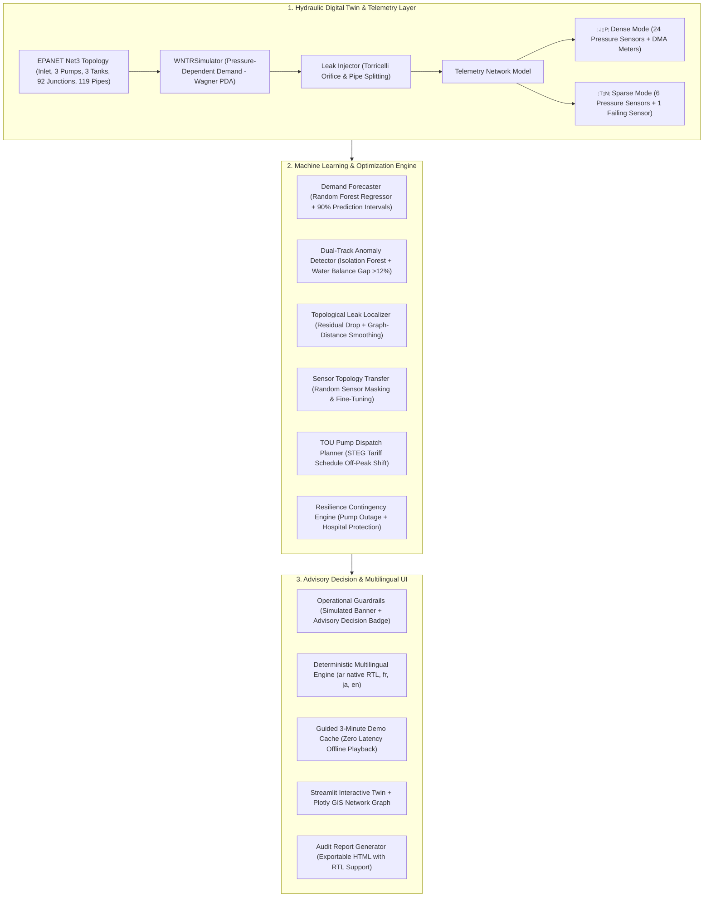
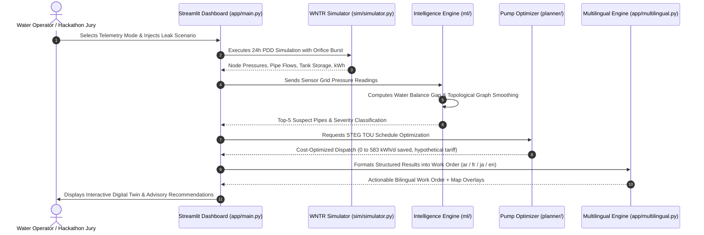

# HydroTwin: System Architecture & Technical Design

> **MANDATORY NOTICE**: All data in HydroTwin is **100% simulated**. The system operates under the core principle: **The system ADVISES, humans DECIDE** — no automated pump control is performed.

---

## 1. High-Level Architectural Overview

HydroTwin bridges hydraulic engineering (EPANET / WNTR) with modern machine learning and decision intelligence to optimize drinking water networks under energy constraints. It runs **100% locally on a standard laptop** using open-source scientific Python tools.

---

## 2. Component Decomposition

### 2.1 Network & Simulation Engine (`network/`, `sim/`)
- **Topological Ingestion (`network/loader.py`)**: Loads EPANET Net3 (`.inp`), configures Pressure-Dependent Demand (`PDA`), and clusters 92 junctions into 5 municipal districts via spatial K-Means.
- **Topological Graph (`network/graph.py`)**: Builds an undirected NetworkX graph from Net3 link geometries, computing shortest hop distances and spatial adjacency matrices.
- **Hydraulic Solver (`sim/simulator.py`)**: Invokes `wntr.sim.WNTRSimulator` to solve nonlinear headloss equations (Hazen-Williams / Darcy-Weisbach) and pressure-dependent delivery over a 24-hour horizon. Extracts hourly node pressures, pipe flows, pump energy draw ($P = \frac{\rho g Q H}{\eta}$), and tank storage levels.
- **Physical Leak Modeling (`sim/leak_injector.py`)**: Simulates pipe ruptures using Torricelli's orifice equation:
  $$Q_{leak} = C_d A \sqrt{2 g P}$$
  Leaks can be placed at existing junctions or along arbitrary pipe segments by dynamically subdividing pipes using `wntr.morph.split_pipe`.
- **Telemetry Synthesizer (`sim/sensor_network.py`)**: Emulates physical pressure transducers subject to Gaussian measurement noise ($\sigma = 0.4\text{ m}$). Implements two operational modes:
  - **Dense Telemetry (Japanese style)**: 24 strategically distributed loggers + boundary flow meters.
  - **Sparse Telemetry (Utility style)**: 6 loggers with 1 sensor suffering mechanical drift or signal failure.

### 2.2 Machine Learning & Analytical Modules (`ml/`)
- **Municipal Demand Forecasting (`ml/demand_forecasting.py`)**:
  - Predicts hourly district demand based on ambient temperature, diurnal sinusoidal cycles, day-of-week, season, and historical lag variables.
  - Uses a time-based train/test split (80/20) with Random Forest and Gradient Boosting regressors.
  - Generates empirical 90% prediction intervals from out-of-sample residual distributions.
- **Dual-Track Anomaly Detection (`ml/leak_detector.py`)**:
  - *Track A (District Water Balance)*: Flags unexplained discrepancies ($> 12\%$) between bulk district inflow and aggregate customer consumption meters, accounting for permissible non-revenue water.
  - *Track B (Isolation Forest)*: Detects multi-point spatial pressure drops across the sensor grid.
- **Topological Leak Localization (`ml/leak_localizer.py`)**:
  - Computes temporal median pressure residuals over the leak window to filter high-frequency sensor noise ($\sigma = 0.4\text{ m}$).
  - Compares observed residuals against network sensitivity footprints and propagates anomaly weights along the NetworkX topological manifold:
    $$W_{pipe} = \sum_{n \in \{n_{start}, n_{end}\}} \frac{\Delta P_n}{1 + \alpha \cdot \text{dist}_{hop}(n, \text{sensor})}$$
  - Outputs a ranked Top-5 suspect pipe manifest with calibrated inspection probabilities.
- **Sensor Topology Transfer Learning (`ml/transfer.py`)**:
  - Models dense-to-sparse transfer using random sensor masking during pretraining (40% dropout rate).
  - Evaluates performance drop honestly: Top-5 candidate containment decreases from **80.0%** (dense) to **53.3%** (sparse).

### 2.3 Energy Optimization & Grid Resilience (`planner/`)
- **TOU Pumping Optimization (`planner/pump_optimizer.py`)**:
  - Integrates STEG industrial medium-voltage Time-of-Use electricity tariffs:
    - Off-peak (22:00 - 06:00): `0.210 TND/kWh`
    - Standard daytime (06:00 - 18:00, 21:00 - 22:00): `0.295 TND/kWh`
    - Peak window (18:00 - 21:00): `0.380 TND/kWh`
  - Restructures pump dispatch to pre-fill elevated storage tanks during off-peak hours and idle secondary booster pumps during the high-tariff peak.
  - Enforces minimum service pressure constraints ($\ge 15\text{ m}$) while penalizing excess pressure ($> 55\text{ m}$) that accelerates pipe burst rates.
  - Evaluates against the mandatory Net3 default operational control baseline.
- **Power Grid Outage Resilience (`planner/resilience.py`)**:
  - Simulates a 4-hour blackout on primary intake Pump Station 10 (14:00 - 18:00).
  - Contrasts an *Outage-Blind* schedule against an *Optimized Resilience Plan*.
  - Automatically commands pre-fill of storage Tanks 1 & 3 to 95% capacity prior to 14:00 and activates gravity supply routing, maintaining compliance in Priority Hospital District 3 ($\ge 18\text{ m}$).

### 2.4 Multilingual Decision Assistant & Dashboard (`app/`)
- **Deterministic Multilingual Engine (`app/multilingual.py`)**:
  - Generates structured work orders and intent answers across 4 languages:
    - **Arabic (`ar`)**: Full Right-to-Left (RTL) layout support via `dir="rtl"` CSS.
    - **French (`fr`)**: Standard Tunisian utility operational terminology (SONEDE context).
    - **Japanese (`ja`)**: High-legibility typography for JICA and bilateral stakeholders.
    - **English (`en`)**: International hackathon standard.
  - Zero-hallucination guarantee: Answers are 100% grounded in structured hydraulic JSON outputs. Never invents a leak when `has_leak=False`.
- **Precomputed Demo Cache (`app/demo_steps.py`)**:
  - Serializes all 6 presentation steps into `data/demo_cache.joblib`.
  - Guarantees `< 0.2\text{ s}` UI response time on stage, eliminating simulation lag.
- **Interactive Streamlit Interface (`app/main.py`, `app/components.py`, `app/reports.py`)**:
  - Mandatory simulated data banner and human decision badge on every view.
  - Interactive Plotly network GIS visualization colored by dynamic pressure head.
  - Scenario report export generating self-contained HTML audit summaries.

---

## 3. Data Flow & Execution Pipeline

---

## 4. Hardware and Runtime Footprint

- **Operating Environment**: Standard consumer laptop (Windows 11, macOS, Linux).
- **Compute Architecture**: 100% CPU execution; zero GPU or external cloud dependencies.
- **Memory Footprint**: $< 400\text{ MB}$ RAM during full simulation and ML inference.
- **Offline Reliability**: Zero external network or cloud API calls required. All NLP, ML, and hydraulic solvers run completely local.
- **Demo Mode Latency**: $< 0.1\text{ s}$ per step via precomputed `data/demo_cache.joblib`.
